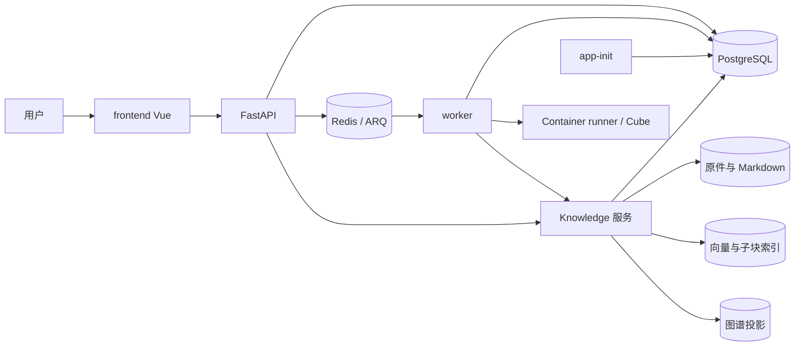

# Yuxi 系统架构

本页帮助开发者从服务拓扑进入 Agent、知识库和工作区链路。稳定边界由仓库根 `ARCHITECTURE.md` 维护，部署方式由[部署参考](../advanced/deployment.md)维护。

## 组件与数据

`frontend` 使用 `src/modules` 的公开入口，`backend/yuxi/api` 适配 HTTP，`modules/<domain>/services` 编排业务，repository 拥有持久查询。API 与 worker 在启动时只校验 Schema；`app-init` 为确认空库建立当前基线并同步内置配置。历史数据库转换必须在停写与备份条件下显式执行。

## Agent 执行

输入先保存 Input 和 Receipt，调度器按优先队列消费并创建 Message、Turn 与 Run。事务提交后 ARQ 唤醒 worker，worker 取得租约，执行 LangGraph 和工具，并将运行结果绑定同一 Turn/Run。最终回答由 Turn 的 `result_run_id` 确定。

PostgreSQL 保存最终业务状态与 checkpoint，Redis 保存投递和短期事件。运行中取消与引导在安全边界响应；工具清理和终态提交完成前仍需维持执行归属。详见[输入队列与调度](./agent-request-queue.md)和[Agent 运行时上下文](./agent-runtime.md)。

## 知识库与本地检索能力

Knowledge 拥有文件原件、Markdown 指针、文件代次、分块与检索参数；MinIO、Milvus 和 Neo4j 保存对象或派生投影。索引重建先建立新代次，再发布可见代次。显式重切保留原件与解析正文，同一请求复用活动作业，重叠文件的不同重切意图返回冲突。

启用父子分块时，子块负责向量召回，父块负责返回上下文；版本与当前文件可见代次共同限制读取。BGE-M3 支持本地原生稀疏向量、远端稠密与本地稀疏组合，以及权重融合和 RRF。依赖本地稀疏模型的配置必须能读取只读模型挂载，失败不能自动切换向量空间。完整状态与验证入口见[知识库机制](./knowledge-base.md)。

## 工作区与 WPS

工作区保留新架构的文件上传、预览、目录操作和项目归属，并提供本地空间、WPS 云盘及其他空间入口。占位空间不宣告连接成功。WPS 的管理员应用配置与个人 OAuth 连接由 identity 分别持久化，文档列表只使用当前用户凭据。公开 HTTPS 回调、开发隧道与部署前提见[WPS 云盘](../advanced/wps-cloud-drive.md)。

宿主目录、沙盒路径和对象 URL 在各自文件边界校验。Agent 知识访问通过知识 MCP 复核当前用户授权和会话选择，不能把展示层隐藏当作权限边界。详见[沙盒与文件系统](./sandbox.md)及[资源权限](./resource-permissions.md)。

## 观察与验证

`/api/system/health` 证明进程存活，`/api/system/ready` 证明接流量的基础条件。作业成功、HTTP 200 或日志本身不能证明产物正确；应回读持久状态、Markdown、分块、向量或文件。文档构建只证明页面可处理，真实数据库、worker、SSE、模型和外部 WPS 验收仍需风险相称的链路测试。
